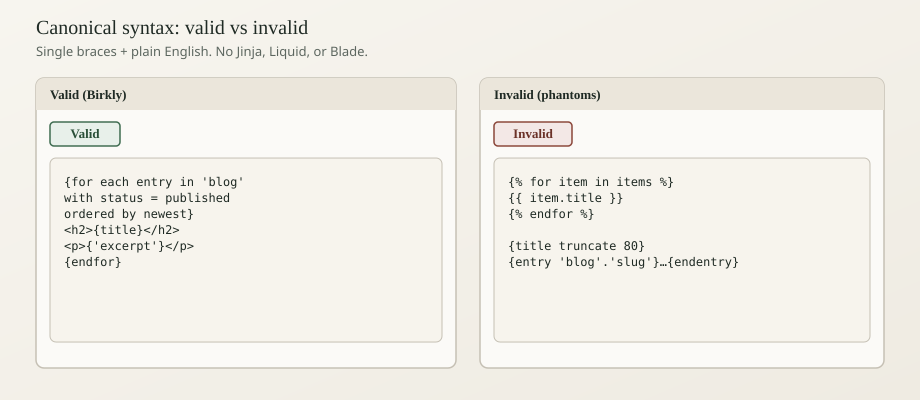

# Canonical template syntax

Birkly has **one** public templating language for site HTML. This page is the human SSOT pointer into that language. The engine source of truth is Birkly `docs/TEMPLATE_LANGUAGE_SPEC.md` (v1.0). Do not invent filters, Jinja syntax, or archived helpers.

## Summary

**In short:** Use **single braces** `{…}` and plain-English sentences. Loops: `{for each entry in 'blog'}…{endfor}`. Fields: `{title}` (system) and `{'my_field'}` (user). Public sites render with `birkly-client.js`. Admin UI uses a separate PHP parser — do not mix admin-only helpers into public HTML.



## Beginner

### Variables

```html
{title}
{slug}
{'excerpt'}
{'price'}
```

- **System fields** (every entry): `title`, `slug`, `id`, `status`, `created_at`, `updated_at`, … — bare.  
- **User-defined fields** — always quoted: `{'content'}`, `{'featured_image'}`.

### Loops (canonical)

```html
{for each entry in 'blog' with status = published ordered by newest}
  <article>
    <h2><a href="post.html?collection=blog&slug={slug}">{title}</a></h2>
    <p>{'excerpt'}</p>
  </article>
{endfor}
```

- Collection handle in **single quotes**.  
- Close with `{endfor}`.  
- Filters: `with …`. Sort: `ordered by …`. Optional trailing `limit 5` (space + number — not `limit=`).

### Single entry

```html
{from 'site_elements' get entry 'header'}
  <header>{'content'}</header>
{endget}
```

### Conditionals

```html
{if 'site_elements'.'hero' exist}
  …
{endif}

{if entry has 'excerpt'}
  <p>{'excerpt'}</p>
{endif}
```

### Forms (special)

Public contact-style forms use **`{entry for 'contact'}…{endentry}`** — that is a **form scaffold**, not the phantom single-entry block. See [Public forms templating](public-forms-templating.md).

### Phantoms — do not use

| Phantom | Use instead |
|---------|-------------|
| `{{ title }}` / `` | `{title}` / `{for each …}` |
| `{entry 'blog'.'slug'}…{endentry}` | `{from 'blog' get entry 'slug'}…{endget}` |
| `{ date "F j, Y" }` | `{created_at format "F j, Y"}` |
| `{title truncate 80}` | Dedicated excerpt field |
| `{'content' strip_tags}` | Plain field or strip in CMS |
| `{from 'blog' get entries limit=5 sort="date:desc"}` | `{for each entry in 'blog' ordered by newest limit 5}` |
| `{ media featured_image }` | `{'featured_image'}` inside `` (see [Media in templates](media-in-templates.md)) |
| `ordered="date:desc"` on regions | `ordered="newest"` / `ordered="order"` |

## Advanced Users

### For developers & AI

**Engines (do not mix)**

| Context | Engine | Location |
|---------|--------|----------|
| **Public site** | Client / shared string engine | `birkly-client.js`, `birkly-template-engine.js` |
| **Admin UI** | PHP template parser | `admin/template_parser.php` |
| Legacy | Archived | Must not be documented as live |

**Syntax rules aligned to TEMPLATE_LANGUAGE_SPEC**

1. Single braces only.  
2. Collections quoted; user fields quoted.  
3. Existence: `{if 'collection'.'entry' exist}`.  
4. Comparisons: prefer `=` (also `==`); `!=`, `<`, `>`, `<=`, `>=`.  
5. Ordering phrases: `newest`, `oldest`, `last-updated`, `order`.  
6. Date filter keyword is **`format`** on date fields.  
7. Public API returns **published** entries for live loops.

**Where the client renders**

`birkly-client.js` scans Light DOM for outermost template-bearing elements, plus explicit `data-birkly-region` / `<birkly-region>`. Explicit children **demote** ancestors. Tags inside `<script>` / `<style>` or closed Shadow DOM are not discovered.

**Admin-only helpers** (never on public sites): `{admin_url …}`, `{translate …}`, `{include_script …}`, etc.

**Validator:** Birkly `scripts/validate-project-templates.php` flags phantom `{entry 'x'.'y'}` while allowing `{entry for 'contact'}`.

## Related

- [Templating overview](templating-overview.md)
- [Cheat sheet](cheat-sheet.md)
- [Loops and lists](loops-and-lists.md)
- [Variables and output](variables-and-output.md)
- [Client setup](client-setup.md)
- [Choose your stack](../04-integration/choose-your-stack.md)
