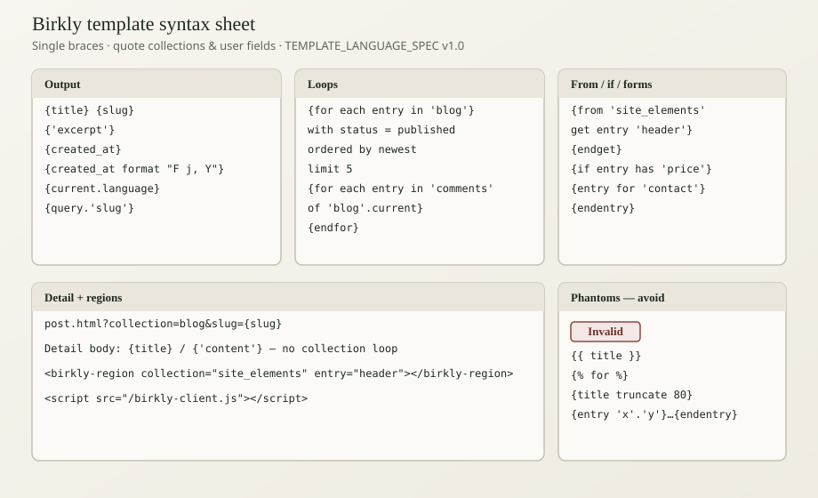

# Templating cheat sheet

Quick reference for Birkly’s public template language, plus phantoms to avoid. Aligns with TEMPLATE_LANGUAGE_SPEC v1.0.

## Summary

**In short:** Single braces. Quote collections and user fields. Loop with `with` / `ordered by` / optional `limit N`. Dates use `format`. Detail pages use URL context. Forms use `{entry for}`. Print this page when building sites or reviewing AI output.



## Beginner

### Output

```text
{title}
{slug}
{'excerpt'}
{'content'}
{created_at}
{created_at format "F j, Y"}
{current.language}
{current_year}
{query.'slug'}
```

### Loops

```text
{for each entry in 'blog'}
{for each entry in 'blog' with status = published}
{for each entry in 'blog' with status = published ordered by newest}
{for each entry in 'blog' with status = published ordered by newest limit 5}
{for each entry in 'nav' ordered by order}
{for newest entry in 'blog'}
{for each entry in 'comments' of 'blog'.current ordered by newest}
{for each item in 'tags'}
{endfor}
```

### From…get / existence / conditionals

```text
{from 'site_elements' get entry 'header'} … {endget}
{from 'site_elements'.'header' get 'content'}
{if 'site_elements'.'hero' exist} … {endif}
{if entry has 'excerpt'} … {else} … {endif}
{if entry has 'price' <= 15 or entry has 'discount'} … {endif}
{if current.language = 'de'} … {endif}
```

### Regions / client

```html
<script src="/birkly-client.js" data-cms-url="https://cms.example.com"></script>
<birkly-region collection="site_elements" entry="header"></birkly-region>
<birkly-region collection="blog" list ordered="newest">…</birkly-region>
<select data-birkly-language-select>…</select>
```

### Forms

```html
{entry for 'contact'}
  <input name="{email}" required>
{endentry}
{public_form 'contact'}
```

### Detail URL

```text
post.html?collection=blog&slug={slug}
```

On detail: `{title}` / `{'content'}` — **no** `{for each entry in 'blog'}`.

## Advanced Users

### Ordering phrases

| Phrase | Field |
|--------|-------|
| `newest` / `oldest` | `created_at` |
| `last-updated` | `updated_at` |
| `order` | `order` or `sort_order` |

### Phantoms (reject in review)

| Phantom | Use instead |
|---------|-------------|
| `{{ }}` / `` | `{…}` / `{for each}` |
| `{entry 'blog'.'slug'}…{endentry}` | `{from 'blog' get entry 'slug'}…{endget}` |
| `{ date "F j, Y" }` | `{created_at format "F j, Y"}` |
| `{title truncate 80}` | excerpt field |
| `{'content' strip_tags}` | plain field / CMS cleanup |
| `{from 'blog' get entries …}` / `sort=` / `limit=` | `ordered by` + `limit N` |
| `{ media … }` | `{'featured_image'}` in `` |
| `ordered="date:desc"` | `ordered="newest"` |
| Detail page collection loop | URL context + `.current` |
| Manual `/plugins/…/storefront.js` tags | Single `birkly-client.js` — [Project sites and plugins](project-sites-and-plugins.md) |
| Custom `club-gate.js` auth script | `data-user-require-auth` on `<html>` / `<body>` |

### Learning map

| Task | Doc |
|------|-----|
| Mental model | [Templating overview](templating-overview.md) |
| Script tag + plugins | [Client setup](client-setup.md), [Project sites and plugins](project-sites-and-plugins.md) |
| List/detail | [Loops](loops-and-lists.md), [Detail pages](detail-pages-and-url-context.md) |
| Forms | [Public forms templating](public-forms-templating.md) |
| Full tutorial | [Worked site walkthrough](worked-site-walkthrough.md) |
| Spec (CMS) | `docs/TEMPLATE_LANGUAGE_SPEC.md` |

## Related

- [Canonical syntax](canonical-syntax.md)
- [Templating overview](templating-overview.md)
- [Worked site walkthrough](worked-site-walkthrough.md)
- [Client library](../04-integration/client-library.md)
