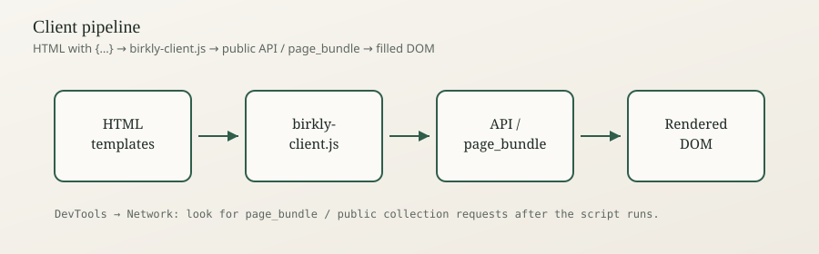
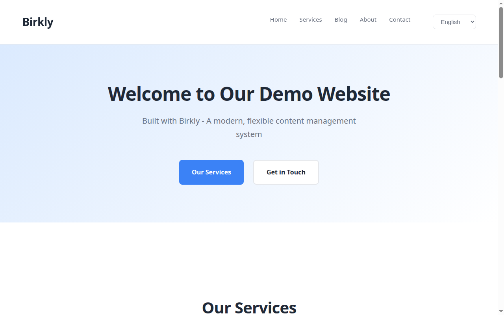

# Client setup

How to load `birkly-client.js` so template tags render — same host as the CMS, external websites, and when to consider SSR instead.

## Summary

**In short:** Every templated HTML page needs `<script src="/birkly-client.js"></script>`. If the site is **not** on the same origin as Birkly, add `data-cms-url="https://your-cms.example"`. Without the script, visitors see raw `{for each…}` text. The default is client-side rendering; SSR is optional for SEO/performance budgets.





<video controls width="720" src="../media/03-templating/client-setup/videos/client-renders-content.mp4">Client renders content</video>

## Beginner

### Same host (project preview / CMS-served site)

When HTML is served from the CMS (e.g. `/project/index.html`):

```html
<script src="/birkly-client.js"></script>
```

Optional enhance helpers (active nav, etc.):

```html
<script src="/birkly-client.js"></script>
<script src="/birkly-components.js"></script>
```

### External website (different domain)

```html
<script src="https://cms.example.com/birkly-client.js"
        data-cms-url="https://cms.example.com"></script>
```

- `src` can be absolute to the CMS host or a local copy of the script.  
- **`data-cms-url` must** point at the CMS base URL so API calls succeed (and CORS must allow your site).

### Checklist

1. Script is on **every** templated page (list, detail, contact).  
2. Collection fields exist before you write loops (see [Content model](../02-content/content-model-overview.md)).  
3. Entries are **published**.  
4. Links use your site URL prefix (`/project/…` when that is your prefix — ask `get_project_info` / admin Project settings).  
5. Open DevTools → Network and confirm a page bundle / public API call succeeds.

### Client vs SSR (plain language)

| Mode | What happens | Choose when |
|------|----------------|-------------|
| **Client (default)** | Browser loads HTML, script fills tags | Most sites, reference projects, local preview |
| **SSR / bake** | Server (or build) fills tags before send | Strict SEO/first-paint budgets — [SSR](../04-integration/ssr-and-build-time.md), [Production optimization](production-optimization.md) |

Start with the client. Add SSR only when you have measured a need.

## Advanced Users

### For developers & AI

**Boot sequence**

1. Parse `data-cms-url` (else same origin).  
2. Discover regions (syntax / `data-birkly-region` / `<birkly-region>`).  
3. Prefetch `site_elements`; build page_bundle requests for collections seen in markup.  
4. `Birkly.processTemplates()` → replace tags → emit events.

**Programmatic**

```js
await Birkly.processTemplates();
await Birkly.processTemplates({ root: el, silent: true, force: false });
```

**Language switcher** — `data-birkly-language-select` on a `<select>` ([Multilingual](multilingual-templating.md)).

**Forms** — `{entry for}` hydrates after the engine emits placeholders ([Public forms templating](public-forms-templating.md)).

**CORS:** External sites need the CMS to allow the site origin for public API / submit.

**AI / WebMCP:** Website tools are separate from CMS MCP. Connect AI apps under **Settings → AI**. See [Website tools](../04-integration/webmcp-tools.md) and [MCP connections](../01-admin/mcp-connections.md).

**Common failures**

| Symptom | Fix |
|---------|-----|
| Raw `{for each…}` visible | Missing script or wrong path |
| Empty page | Unpublished entries / wrong collection slug |
| CORS errors | Set `data-cms-url`; allow origin on CMS |
| Unstyled assets | Wrong site URL prefix |

## Related

- [Templating overview](templating-overview.md)
- [Client library](../04-integration/client-library.md)
- [Website integration](../04-integration/website-integration.md)
- [SSR and build-time](../04-integration/ssr-and-build-time.md)
- [Web components](web-components.md)
- [Cheat sheet](cheat-sheet.md)
